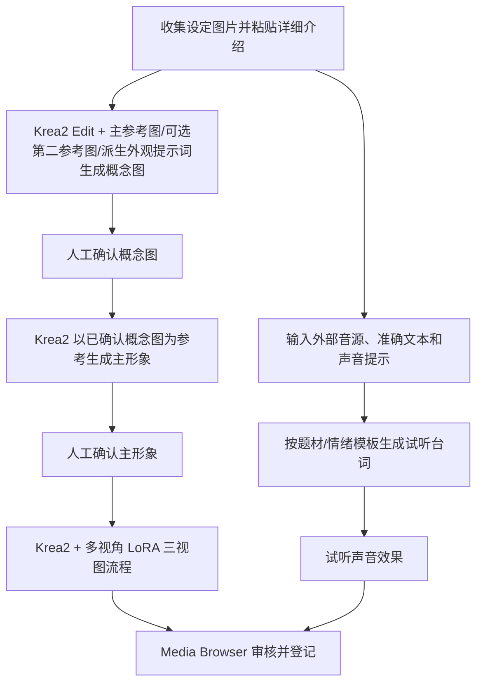

# [Sean] H3 Reference 创建与编辑流程

> Owner: Sean  
> 状态：产品设计决策记录 v1.6（2026-10-01）  
> 任务：`remote-47125329-b0d9-41f8-86bb-bf071543701a`

## 1. 范围

本文记录 Reference 实体创建与编辑阶段的功能和使用流程。当前只讨论如何输入创作参数、调用固定 ComfyUI 工作流、审核创作结果并回到 Media Browser 完成闭环。

本阶段不细化查看与管理功能，不冻结实体关系的完整类型与界面，也不实现分支管理。数据设计需要支持实体关系在以后补建和持续修订，并追踪关系及被引用资料对生成结果的影响。创建和编辑期间的主要操作入口在 Media Browser；用户可直接在 Media Browser 提交生成并查看进度与结果。ComfyUI 是可选的细节观察入口，用于查看对应固定工作流的节点执行和中间输出。

此前的工作台草案 [`docs/47_h3_reference_workbench_redesign.md`](47_h3_reference_workbench_redesign.md) 属于另一任务，记录了 ComfyUI 画布为主界面的较早提案。本任务已确认创建/编辑参数、生成启动、进度查看和结果审核都由 Media Browser 承担；用户可选进入 ComfyUI 查看同一次生成的节点和中间输出。打开 ComfyUI 不改变 Media Browser 中的生成任务或操作流程。当前创建/编辑故事板以本文件为准；查看/管理是否共用界面仍待讨论。47 号草案归属其他任务，本文件不改写它；进入整体实现规划前再由相关任务对账。

## 2. 已确认设计原则

1. **工作流在创作期间固定。** 节点和代码是可复用的生成模块；用户运行时不编辑或重连工作流。工作流维护者升级流程时发布新模板版本，不改写已运行的模板。
2. **创作输入在 Media Browser 设置。** 提示词、角色/对象设定、参考素材、流程选项，以及运行前需要确认的路径和命名规则，均在 Media Browser 的创作会话中配置。
3. **Media Browser 内完成日常生成。** 用户在当前界面配置参数、点击生成、等待完成并查看结果；界面显示素材级运行状态和进度。需要节点级细节时，可打开 ComfyUI 查看同一次运行的流程与中间预览。进入 ComfyUI 是可选观察行为，不要求用户切换过去才能生成或拿到结果，也不改变 Media Browser 中的运行。
4. **最终审核回到 Media Browser。** 本次运行的结果关联到创建会话；用户返回后查看汇总产物，选择、审核并纳入实体资料。
5. **Media Browser 与 ComfyUI 解耦。** 对象资料、创作会话、步骤依赖和运行记录不以内嵌节点图作为数据模型。ComfyUI 是可替换的工作流执行适配器。

## 3. 创建与编辑功能列表

### 3.1 Media Browser 创作会话

- 新建或继续一个实体的创建/编辑会话。
- 当前通过文本粘贴/注入编辑实体详细介绍；后续再做小说导入与总结系统。图片生成提示词由详细设定（尤其外观部分）生成，再按当前步骤和情境补充；提示词与原始介绍分别保存、分别记录版本，避免生成的提示词反向覆盖设定。
- 为当前步骤选择参考素材，确认可调选项、路径规则和输出命名。
- 展示步骤依赖、前置条件、已确认输入和可启动状态。
- 固定主面板布局：左侧展示“设定收集”“主形象确认”“三视图”“声音”及状态；右侧随选中项展示对应输入、生成结果、进度和操作。设定收集阶段集中管理前期设定图片。主形象确认阶段包含概念图生成和主形象生成两个步骤：概念图用一张主参考图、可选第二张参考图和提示词生成目标图片；本地 Krea2 Edit 能力目前限于这两张输入，不假定支持任意多 ref。未选入本次生成的关联物只显示更新状态。主形象以已确认概念图作为参考图生成并确认主要视觉基准。两步都使用 Krea2 和所选风格，具体输入契约需与已验证管线对齐。三视图调用既有多视角 LoRA 流程；声音面板生成适合作为 Reference 的声源及默认试听样音。
- “添加资料”属于“设定收集”的操作，只在该面板出现；概念图、主形象、三视图和声音面板从已收集/对应输入中选择资料，不重复提供全局添加资料入口。
- 三视图是一张包含多个视角的合成图，作为一个结果审核、确认和登记；不拆成三个独立资产位。当前测试布局为脸部近景、全身正面、全身背面。
- 创建/编辑各面板复用统一的生成交互布局：输入与参数、生成状态/进度、结果预览、确认/恢复操作以及可选 ComfyUI 详情入口在各面板中保持一致位置，具体内容按步骤变化。
- 顶部全局导航的第一、第二行，以及“浏览和管理”与“创建和编辑”的切换方式尚未设计；当前界面草图聚焦工作区主体，不把顶部导航结构画成既定方案。
- Midjourney JIBS 是用户已有的图片风格 LoRA。概念图和主形象的风格可由提示词、输入图和 LoRA 共同决定；后续将风格整理为可复用设置。其 UI 控件、设置内容和是否允许逐项覆盖待确认。
- 提示词、输入图片及步骤参数可持续编辑；每次提交记录本次实际输入快照。编辑后重新生成会形成新候选，不覆盖已确认结果。
- 人物、物品、服装、装备、发型等关系允许逐步补建和修订，不要求收集某实体时其关联实体都已存在。重要武器/物品是独立实体，可被多个角色复用；一个角色也可关联多套武器、服装、发型等设定。暂时无法关联到实体的资料可先作为待关联项记录，之后解析为正式实体关系。具体关系类型和 UI 后续细化。
- 生成结果记录本次实际使用的实体、关系、引用素材及其版本。后续补建关系或修订被引用实体时，只将确实依赖这些输入的结果标为“需复核/可重生成”；不自动覆盖、删除或静默替换已确认结果。
- 依赖项发生更新后，关联物品保留“已更新”状态，受影响的形象结果显示“待更新”，并持续显示到用户依据新 ref 重新生成且确认了新版形象为止。仅生成候选、未确认时不能清除待更新状态；若用户明确决定继续使用旧形象，应提供显式保留旧版的处理记录，不能把它显示成已根据新 ref 更新。
- 用户在 Media Browser 查看变更影响，调整本次生成输入后显式重跑；新结果仍走候选审核和确认流程。无关的生成结果不受影响，旧运行及其输入快照可追溯。
- 新候选完成后，用户明确选择保留新结果，或恢复此前已确认版本；创作界面需要始终能识别当前候选和当前确认结果。
- 用户可直接在 Media Browser 点击生成，并在右侧详情面板查看生成状态/进度、完成结果或错误信息。
- 需要查看节点级进度和中间输出时，可从当前生成项打开其 ComfyUI 流程，查看与本次生成关联的执行；这不会改变、暂停或替代 Media Browser 中的生成和结果回流。
- 在创作会话内记录每次运行实际提交的步骤提示词、参数、输入素材引用、工作流模板版本和输出关联，以便本次返回和审核。会话/草稿的长期保留及清理策略尚未确定；本条不代表实现分支管理。
- 提供可选的 ComfyUI 详情入口，并支持返回原创作会话；不把 ComfyUI 作为启动和完成生成的必经页面。
- ComfyUI 执行适配器将运行状态与产物回传 Media Browser；用户在 Media Browser 审核、选择和登记。
- 修改提示词或输入选项后，可重新启动受影响步骤；不覆盖已确认的素材。
- 图片生成提示词以详细实体介绍为来源，尤其提取外观设定；再按概念图/主形象/三视图各自目的及本次情境生成对应指令。若用户修改派生提示词，后续实体介绍变化应生成可比较的新提示词版本，不能静默覆盖手工修订。H3 Ref2VA 视频提示词属于后续消费阶段，与 Krea2 图片提示词分开。
- 声音使用 Breeze TTS，支持两种输入方式：提供外部音源时按音源选择克隆/声音引导模式；只有提示词时按声音设计模式生成。声音提示可与音源共同使用。无论何种模式，试听台词均由系统按题材和情绪模板预置并批量生成，用户直接试听，不手动添加台词。用音源时需提供准确转写文本。试听通过的声音如何登记为 Reference 素材待确认。BGM 绑定属于后续扩展。

### 3.2 固定 ComfyUI 工作流

- 工作流封装固定节点图和执行逻辑。
- 通过预先声明的输入项接收提示词、已选素材、流程选项和输出规则。
- 若模板提供节点预览或分支/选项，由 ComfyUI 原生界面呈现；是否将部分高层选项提前暴露在 Media Browser 待后续设计确认。
- 执行结果必须能关联到正确的创作会话和运行；使用 ComfyUI 执行记录、会话参数或其他关联机制属于实现设计，当前不冻结具体方式。
- ComfyUI 的临时输出在 Media Browser 审核后再导入实体资料库；`ComfyUI/output` 不作为长期归档。

### 3.3 本阶段明确不做

- 不做嵌入式节点画布或 Media Browser 内的 ComfyUI 节点预览复刻。
- 不允许创作用户在运行会话中修改工作流图或代码。
- 不做分支树、分支合并及完整草稿历史管理；但每项素材必须保留当前确认版本，并将新生成结果作为候选，供用户选择保留或恢复旧确认版本。
- 不细化实体浏览、搜索、分类等查看管理体验。
- 不冻结人物、服装、状态、物品等实体关系的完整类型系统与管理界面；关系需支持后补、改链和解除，并可追踪下游依赖。
- 不在本阶段实现多个实体映射到 H3 Ref2VA 参数及提示词控制。

## 4. 步骤依赖与并行关系

不能把创作建模为所有步骤首尾相接的单一流程。步骤按真实前置条件组成依赖图：

- 三视图依赖已确认的主形象；任一前置项未确认时，不允许启动三视图步骤。三视图沿用已测 Krea2 + LoRA 三视图流程，不包含自行训练 LoRA。
- 声音流程不依赖视觉支线，可并行开始；试听台词由题材/情绪模板生成，外部音源配准确文本作为声音参考输入。
- 每个步骤的审核结果独立；某一支线失败或重做，不应阻塞无依赖的另一支线。
- 提示词或前置素材修改后，系统需记录本次运行实际使用的输入；旧产物仍可识别为基于旧输入，不自动冒充新输入结果。
- 实体可能先于其关联对象创建。用户可暂存尚未解析的关联资料，等目标实体建立后再补链；补链不会伪装成生成时已使用过该对象。
- 每次运行保留输入快照，包括当时选择的实体/关系、引用素材版本、提示词、参数和工作流模板版本。确认结果因此可解释为“由哪些具体版本生成”。
- 当某个被引用实体、关系或素材发生修订，系统比较新旧输入依赖，并标出受影响的下游结果供用户复核。只有实际使用了变更项的结果需要提示；不自动启动生成。用户可以接受旧结果、编辑输入后重跑，或确认新候选。
- 变更状态要持续可见：被引用物品标记“已更新”，受影响形象标记“待更新”。只有用当前新 ref 生成并由用户确认新版形象后，相关待更新标记才清除；候选尚未确认时继续保留。
- 一条关系后来被补建或改指向新实体时，相关步骤可重新选择该对象并重跑。比如角色武器更新，只影响实际把该武器作为输入的概念图/主形象/其他产物；没有引用该武器的声音或其他结果不应被标脏。
- 此处的“分支”只表达可追溯的输入版本和候选结果，不要求第一阶段提供分支树、合并或自动传播重生成。

## 5. 使用流程

1. **从 Media Browser 开始**：选择实体并进入创建/编辑会话。
2. **填写本次输入**：编辑实体设定和提示词，选择当前步骤的素材、选项及输出规则。
3. **确认可运行步骤**：Media Browser 左侧列出设定收集、主形象确认、三视图和声音。设定图收集完成后，在主形象确认阶段依次用 Krea2 生成概念图和主形象，并选择风格。声音可独立上传外部音源、准确文本和提示，按题材/情绪模板生成样音。
4. **在 Media Browser 生成和观察**：用户直接点击生成，在当前界面等待，并在右侧查看运行状态/进度、完成结果或错误。如需查看节点图和中间输出，可选打开与本次运行关联的 ComfyUI 流程；仅查看 ComfyUI 不改变外部生成任务，生成完成和结果审核仍回到 Media Browser。如工作流内有固定分支选择，则沿用模板提供的选项。
5. **分步确认视觉输入**：概念图通过后继续生成主形象；主形象通过后再启动 Krea2 + 多视角 LoRA 三视图流程。声音支线独立生成和试听。
6. **返回 Media Browser**：按会话/运行标识汇总本次产物，显示来源步骤和所用输入，用户审核并选择要保留的素材。
7. **补建关系或修订资料**：创建实体时若关联对象尚未建立，先记录为待关联资料；对象建立后再链接。关系、武器或其他被引用设定更新后，Media Browser 按运行快照列出可能受影响的已确认结果，供用户逐项复核。
8. **编辑并重跑**：需要调整时在 Media Browser 修改该步骤的提示词、输入图片、已关联对象或参数，再启动新运行；无需进入 ComfyUI。工作流图保持不变。新结果完成后，用户选择保留为当前确认结果，或恢复到此前已确认版本。

## 6. 解耦边界

建议按以下职责分开设计，避免 UI、实体数据和 ComfyUI 工作流互相绑定：

| 模块 | 负责内容 |
|---|---|
| 实体领域数据 | 实体设定、可后续补建/修订的关系、提示词修订、素材引用及审核结果；不存储 ComfyUI 节点图作为唯一真源 |
| 创作会话 | 步骤依赖、每次运行输入快照、当前步骤状态、运行关联、受影响结果提示及结果汇总 |
| 工作流目录 | 固定模板及版本、输入参数契约、输出类型和步骤用途 |
| 参数映射适配器 | 将 Media Browser 的语义字段映射到指定模板的节点输入；前端不直接拼装节点图 |
| ComfyUI 执行适配器 | 加载模板、提交运行、观察执行事件和解析输出；不拥有实体审核与版本规则 |
| 素材登记服务 | 将审核通过的临时输出导入实体资产存储，并保留来源和文件信息 |

Media Browser 面向用户展示业务参数；工作流适配层负责 ComfyUI 节点输入映射。每次运行记录实际模板版本和参数快照，避免模板升级改变既有运行的解释。

## 7. 冒烟测试范围与当前状态

当前尚无 Media Browser 创建/编辑界面及其 ComfyUI 会话桥接实现，因此本方案**没有可执行的集成烟测**。仓库现有 Breeze TTS 自检和 Reference manifest 校验只覆盖局部能力，不能替代下列集成烟测。设计阶段不启动 ComfyUI 或生成任务。

实现后进入集成前至少应烟测：

1. Media Browser 提交的提示词、参考素材、选项和输出规则准确映射到指定固定工作流输入，运行时不改写已登记模板。
2. 打开的 ComfyUI 工作流与创作会话、实体和参数版本匹配；用户可正常查看节点预览和执行状态。如模板包含分支或选择器，再验证该模板对应的交互。
3. 完成、失败、取消等执行结果能关联回原会话；输出不会串到其他实体或运行。
4. 三视图的概念设定/形象前置门有效；提示词确认后声音步骤可在视觉流程结束前单独启动。
5. 选定输出可回到 Media Browser 审核和登记；临时输出与长期实体资产路径分离。

## 8. 后续讨论

创建/编辑工作区功能更新：左侧阶段为“设定收集”“主形象确认”“三视图”“声音”。设定收集除图片外，当前直接粘贴/注入详细实体介绍；小说导入和总结系统留后续。图片提示词从详细介绍（尤其外观）派生，再加入步骤指令与本次情境；介绍和提示词分开保存。概念图使用一张主参考图和提示词，技术路径允许增加一张可选第二参考图；不假定支持任意多图。确认概念方向后，以已确认概念图为参考图生成/确认主形象。Midjourney JIBS 是用户已有的风格 LoRA；提示词、输入图和 LoRA 共同决定风格，具体 UI 设置与后续可复用风格配置待确认。重要武器/物品独立建档，可供不同角色复用；角色也可以关联多种服装、发型、装备等设定。未选入当前生图输入的关联 ref 显示“已更新”；不同 ref 的任意多图联动留给后续 H3 Ref2VA 视频生成流程。三视图采用已经测试过的 Krea2 + 多视角 LoRA 固定流程，不含 LoRA 训练；本地探索批次实际输出为左侧脸部近景、中间全身正面、右侧全身背面，来自 [`T-comfy-ops-48 三视图实验`](../experiments/krea2_quadview_stability_20260928/README.md)。实验报告称其为探索性结果且未运行 H3，因此该 UI 选择不等同于 H3 端到端生产链已验证；与 Reference 手册的正式全视角链路需后续对账。声音支持输入音源或仅提示词两种生成入口，并由 Breeze TTS 根据题材和情绪模板预置台词批量生成试听；输入音源时需提供准确转写。BGM 绑定后续扩展。试听样音是否登记为正式 Reference 声音待确认。Media Browser 内直接生成并展示进度；ComfyUI 可选查看同次运行节点细节和中间输出，不影响外部流程。生成可重试、调参；结果由用户确认。实体关系可以后补和修订；按每次运行的实体/关系/素材版本快照标记受影响结果。被用于本次生成的输入项更新后持续显示“已更新”，依赖它的形象持续显示“待更新”，直到新版本输入生成的形象被确认；未进入输入的关联 ref 只显示其自身更新状态。旧确认结果保留可追溯。分支管理后续再评估。关系类型、待关联项的交互、多套设定的组合方式及查看/管理是否共用界面仍待讨论。

当前创建/编辑工作台界面草图：[sean_h3_reference_creation_workspace_v3.png](design/sean_h3_reference_creation_workspace_v3.png) 为旧版总体布局基线，需按上述统一面板规则更新。新图应展示设定收集、概念图、主形象、合成三视图、声音五种右侧状态；顶部全局导航保持待定。

## 9. 图片与文字流程逻辑审查

本节记录审查中发现的边界和未冻结项，避免把设计假设画成已确认或已验证能力。

### 9.1 必须在界面定稿前讲清楚

- **概念图是参考图引导的目标图生成。** 用户明确这一步利用提示词和参考图片生成目标图；提示词可包含要呈现的情境/相关设定，让 ref 呈现预期样子。主形象以已确认概念图为参考图，成为主要视觉基准。
- **把“实体说明”和“生成指令”分开。** 实体说明可以很详细、由小说总结而来；图片生成提示词从实体说明（尤其外观）生成，再加上步骤目的与本次情境。两者分别保存版本，提示词手工修改不应覆盖介绍。H3 Ref2VA 视频提示词是后续消费阶段，不能与 Krea2 图片提示词共用一个无类型文本框。
- **区分生成状态和资料新鲜度。** 例如“运行中/失败/有候选/已确认”描述任务或候选状态；“当前/待更新”描述确认形象相对最新设定是否过期。某步骤可以没有运行，但已有确认图仍处于待更新状态。
- **更新沿实际依赖传播。** 本次生成实际使用的参考图、提示词或描述版本发生变化时，概念图需待更新；主形象若基于旧概念图生成，也需要待更新；三视图若基于旧主形象生成，则继续待更新。未传入的关联物品更新只显示“已更新”；选入新一轮生成后，旧确认图按运行快照标记待更新。直到相关新形象逐级生成并确认，沿途对应的待更新状态才清除。
- **素材版本要可选且可追溯。** 一个实体可能有多张设定图、多个生成候选和多个关系对象；启动时需明确本次选用了哪张参考图/版本及提示词版本。仅保存实体 ID 不够，否则后续无法判断旧结果的实际输入。
- **关系是可复用的多对多设定。** 重要武器/物品独立建档，不复制到角色资料中；可被多个角色引用。一个角色可有多种武器、服装、发型等关联设定。当前概念图流程使用一张主参考图、可选第二张参考图和提示词；未选入本次运行的其他 ref 只显示“已更新”，实体关系和版本信息仍应保留，以便后续 H3 视频生成组合多 ref。

### 9.2 当前设计与本地证据的边界

- Krea 官方网页产品提供提示词结合参考图的生图入口；但官方开源 Krea2 基础推理接口主要是文字生图。当前本地 ComfyUI 可通过社区 [`ComfyUI-Krea2Edit`](https://github.com/lbouaraba/comfyui-krea2edit) 扩展及对应 Identity Edit LoRA，把参考图同时送入图像外观和 Qwen3-VL 语义条件，再用提示词生成目标图。该扩展文档提供一张主参考图和一张可选第二参考图，可用于有限的双图条件生成；没有证据支持像 H3 Ref2VA 一样接入任意多张 ref。已关联但未作为本次输入的物品只显示“已更新”，不把未使用的新 ref 误记为已用于形象生成。后续视频流程再处理任意多 ref 组合。
- [`docs/40_krea2_prompt_and_identity_pipeline.md`](40_krea2_prompt_and_identity_pipeline.md) 的本地人物管线把身份建立、显著元素移除和 JIBS 风格化拆成不同模式，并指出把身份锁定、内容删除和风格化混在一次 style-only 生成里的旧做法未通过。因此参考图引导、Identity Edit LoRA 与 JIBS 风格 LoRA 的准确组合仍须按目标实体类型验证，不能仅由 UI 流程假定已解决。
- [`docs/45_ref_asset_handbook.md`](45_ref_asset_handbook.md) 规定当前正式全视角资产链为主图驱动的 H3 全视角生成与抽取；本任务提出 Krea2 + QuadView LoRA 生成一张三视图合成图。后者在本地实验中有探索结果，但实验标注为非 canonical、未接入 H3 验证。因此界面可按用户确认展示为一个合成结果，但暂不应标记为已验证的 H3 正式 Reference 输入。

### 9.3 下一轮需确认

1. 主形象以概念图作为参考输入已确认；早期设定图是否还要同时参与仍待技术参数契约验证。
2. 用户粘贴详细介绍、查看自动派生的图片提示词并修改后，源介绍变化时如何呈现提示词差异。
3. Krea2 Edit 双图输入与 JIBS 风格 LoRA 的组合需烟测；超过两张的服装/武器/发型 ref 只显示更新状态，后续在 H3 Ref2VA 视频流程中再设计多 ref 映射。
4. 三视图合成图在未来 H3 流程中的消费方式与验收条件；单张预览/登记不自动代表下游兼容。
