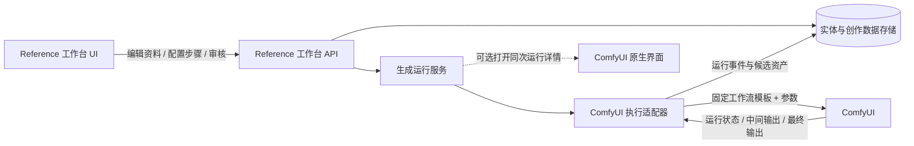

# H3 Reference 创建工作区实现前架构设计

> Owner: Sean。状态：实现前设计稿，基于 2026-10-01 代码库只读盘点与 `docs/48` v1.6 已确认产品决策。本文不代表已实现或运行时验证。

## 1. 结论摘要

本项目定位为 AI 视频生成工具第一阶段的 **Reference 参考资料创建与管理工作台**，产品名称待定。它采用独立项目，前端技术栈为 React + Vite 8；不在 `comfyui-browser` fork 内开发，也不把旧 `web-shotlist` 改造成新主界面。普通媒体资源仍由现有 `comfyui-browser` 插件独立浏览；新工作台专注于实体参考资料、提示词、确认版本和生成运行。ComfyUI 作为固定工作流执行器，通过适配器提交参数、观察运行并回收输出；ComfyUI 原生界面仍是可选的同次运行细节入口。



**代码、ComfyUI 扩展和工作流的职责：**

| 部分 | 第一阶段职责 | 所在边界 |
|---|---|---|
| 应用代码 | Reference 浏览/创建/编辑 UI、实体与素材管理、输入快照、运行历史、进度/错误、候选审核、确认/恢复、资产登记 | 独立 React + Vite 8 项目及其 API 服务 |
| 执行适配器 | 工作流目录、参数校验和映射、提交/取消/重试、运行状态采集、结果关联与导入 | 独立 Reference 工作台的 API 服务 |
| 固定工作流 | Krea2 概念图、主形象、三视图 LoRA、Breeze TTS 等实际生成图；每个发布版本声明输入和输出 | ComfyUI 工作流 JSON/模板目录 |
| ComfyUI 自定义节点 | 提供模型/生成能力；仅在现有节点不能表达必要生成操作时补充节点 | ComfyUI 扩展包，按能力独立维护 |
| ComfyUI 前端扩展 | 可选的“查看本次运行”导航/配对入口，不承载实体业务状态 | Reference 工作台可以先通过链接进入；同次运行深链验证通过后再决定是否提供配套扩展 |

固定工作流指运行时不修改节点图。应用传入语义参数，由执行适配器映射到模板约定的节点输入。维护者发布模板新版本时保留旧版本标识，既有运行继续指向实际使用的版本。

## 2. 代码库现状盘点

代码结构查询使用了仓库 `.codegraph/` 索引；代码结论依据索引返回的当前源码。只读文件枚举确认 `web-shotlist` 是目前仓库内最接近实体管理的 Web 应用，`packages/sean_material_gallery` 是 ComfyUI 菜单扩展与旧素材预览页。

| 现有部分 | 已有能力 | 对 Reference 工作区的缺口 |
|---|---|---|
| `web-shotlist/apps/web` | React 页面、剧本/拍摄本/提示词页面、实体侧栏、项目和回收站 | 是旧 AI 视频工具的一部分；有实体管理能力，但没有本次规划的 Reference 创建与生成审核闭环 |
| `web-shotlist/apps/server` | Fastify API、实体 CRUD、实体资产上传/列表、任务轮询 | 当前任务仅保存在进程内存，单实例只允许一个任务运行，没有完整运行快照、恢复和阶段事件持久化 |
| `web-shotlist/apps/server/src/art.ts` | 读取 ANIMA 工作流模板副本、映射提示词和 seed、调用 ComfyUI `/prompt`，轮询 `/history` 并导入图片 | 模板路径和节点 ID 在生成逻辑中直接编码；未覆盖 Krea2 Edit 双图、JIBS、三视图 LoRA 和 Breeze Reference 声音流程 |
| `web-shotlist/apps/server/src/assets.ts` | 按实体目录保存图片、声音和文件 | 资产无稳定独立 ID、版本/校验和/多实体引用表；路径本身承担身份，难以维护共享引用与引用数 |
| `web-shotlist/packages/shared/src/types.ts` | 实体说明、外观、声音、关系列表、变体、项目输入等类型 | 关系是轻量文本列表；没有实体版本、派生提示词版本、生成运行和候选/确认状态契约 |
| `packages/sean_material_gallery` | ComfyUI 菜单按钮启动独立 HTTP 页面；旧页面浏览 `input/material` 与 `material_b` 下的视频 | 是旧视频文件查看页，不是普通资源浏览插件，也不支持实体、关系、创作步骤或任务回流 |

仓库中已有工作流示例 `workflows/anima_alya_169_t2i.json`，当前代码以磁盘模板为基础拷贝 JSON 后修改参数再提交。新工作区可以复用“固定模板 + 参数映射”的思路，但应避免把具体节点 ID、ComfyUI 文件路径或输出目录放进 React 组件和实体数据结构。

**范围澄清（Sean，2026-10-01）：**`web-shotlist` 是此前 AI 视频生成工具的一部分，其中实体资产管理也是已有能力；本次重做的是 AI 视频生成第一阶段的 Reference 参考资料创建与管理工作台。它的产品名称待定。普通媒体资源继续通过第三方 `comfyui-browser` 插件浏览；该插件是 Sean fork 并做过本地改造，本次保持独立，不将它当作新工作台的宿主或代码基础。

目标 fork 已定位为 `/home/sean/projects/ComfyUI/custom_nodes/comfyui-browser`。前述代码索引结论只覆盖 `comfy-ops` 仓库；本节随后另对该 fork 做了只读源码和 Git 状态盘点。本地工作树包含用户未提交修改，本次未触碰这些改动。

## 3. 建议的领域数据边界

当前实体与资产文件目录的模型适合轻量单用户操作，但 Reference 工作区增加了共享素材、多版本、生成输入快照和回收站引用规则。建议将**结构化元数据**放在可事务更新的本地数据库，将**媒体二进制**放在文件存储；不把 ComfyUI 输出目录或工作流 JSON 当成业务主库。

| 记录 | 主要字段/约束 | 用途 |
|---|---|---|
| `Entity` | `id`、名称、flag/type、详细介绍、创建/删除状态 | 稳定实体身份；介绍通过文本粘贴/注入，小说导入以后再做 |
| `Asset` | 稳定 `assetId`、媒体类型、存储 key、hash、来源、尺寸/时长、创建时间 | 图片/音频/其他文件的不可变内容记录，可由多个实体或版本引用 |
| `EntityAssetLink` | `entityId`、`assetId`、用途、版本/状态 | 表达设定收集图、概念图、主形象、三视图和声音；支持多对多引用 |
| `EntityRelation` | 来源实体、目标实体、关系类型/说明、有效状态 | 支持后补关系、一个物品供多角色复用、关系修订；本阶段只定义可扩展契约，不冻结完整关系 UI |
| `PromptRevision` | 实体、步骤、正文、来源介绍版本、修订号、时间 | 介绍和派生/手工修改的提示词分开保存；介绍变化时可比较新旧派生文本 |
| `WorkflowTemplate` | 模板 ID、用途/步骤、版本、固定工作流文件、参数 schema、输入/输出端口 | 目录化发布 ComfyUI 固定工作流；对应用暴露稳定语义参数 |
| `GenerationRun` | 实体、步骤、模板版本、输入快照、ComfyUI `prompt_id`、状态、时间、错误 | 每次生成都是独立可追溯运行；调参重试创建新 run，不覆盖确认结果 |
| `RunOutput` | `runId`、输出序号、临时/已登记 asset ID、审核状态 | 连接运行输出与候选资产 |
| `ConfirmedRevision` | 实体、步骤、asset ID、来源 run、确认时间 | 指明当前生效素材；可显式恢复之前确认版本 |

删除遵循此前确认的语义：移入回收站时保留所有引用关系，不减少引用计数；从回收站彻底清空时才解除该实体的关系/素材引用。素材被多个实体使用时，引用数归零也暂不自动物理删除。文件删除、回收站动作和引用计数更新必须在同一业务事务里保持一致。

**导出/下游消费契约：**数据库及其媒体目录是 Reference 工作台的编辑时权威数据。后续视频工作流不直接读取应用内部数据库；由应用导出版本化 `ReferenceManifest`（稳定实体/资产 ID、当前确认版本、路径或可解析 URI、媒体类型、关系快照、来源版本），执行适配器再把用户选中的 manifest 条目映射到 H3 Ref2VA 对应输入。第一阶段可以先交付此 schema 和少量人工/调试导出，不提前实现多 ref 视频装配。

```json
{
  "format": "h3-reference-manifest",
  "version": 1,
  "entityId": "entity-id",
  "entityRevision": 3,
  "assets": [
    { "assetId": "asset-id", "role": "confirmed_concept", "revision": 2, "uri": "asset://asset-id" }
  ],
  "relations": []
}
```

稳定 ID 和 manifest 让实体组织方式后续可扩展，同时避免当前单个 ComfyUI 工作流的文件路径成为跨系统永久契约。

## 4. 生成运行与模板接口

应用只向用户呈现业务输入，ComfyUI 只接收执行输入。每个模板用独立清单声明用途、版本、依赖、可调字段、默认值、校验规则、ComfyUI 节点输入映射及输出提取规则。React UI 不直接构造 ComfyUI API 的节点图。

```yaml
id: reference.concept.krea2-edit
version: 1
step: concept
inputs:
  primary_image: { type: asset, required: true }
  secondary_image: { type: asset, required: false }
  prompt_revision: { type: prompt, required: true }
  style_lora: { type: lora_profile, required: false }
outputs:
  - { name: concept_image, type: image, cardinality: many }
```

应用服务的边界可以按以下接口切分（名称为设计建议，不是已存在 API）：

| 接口/模块 | 调用方向 | 责任 |
|---|---|---|
| `ReferenceService` | UI → API | 实体介绍、flag、实体与资产引用、关系、素材新鲜度、当前确认版本 |
| `PromptService` | UI → API | 查看/编辑某实体某步骤的提示词修订；派生提示词与来源介绍版本关联 |
| `WorkflowCatalog` | API 内部 | 列举允许的固定模板及其输入 schema；不接受前端上传任意 workflow JSON |
| `GenerationService` | UI → API | 校验步骤前置条件、保存输入快照、启动 run、重试/取消、返回状态和候选 |
| `ComfyExecutionAdapter` | GenerationService ↔ ComfyUI | 参数映射、提交固定图、监听/查询执行状态、解析最终和中间输出 |
| `AssetService` | 运行服务/API | 安全登记候选文件、维持稳定资产 ID/来源、处理回收站引用规则 |
| `ReferenceManifestExporter` | API → 文件/API | 导出已确认版本与关系的稳定下游清单 |

状态建议分别表达执行与内容审核，避免一个状态字段混合“运行中”和“待更新”：

- 运行：`queued`、`running`、`succeeded`、`failed`、`cancelled`。
- 候选：`pending_review`、`confirmed`、`discarded`。
- 确认资料新鲜度：`current`、`stale`。
- 每个 run 固化实体介绍版本、派生/手动提示词版本、实际选入的素材/实体关系版本、可调参数、随机种子、模板 ID/版本和输出。
- 输入调整后创建新 run；候选完成但未确认时，旧确认版本仍是当前使用版本。显式确认新候选后才更新“当前确认”；显式恢复则重新指向之前确认版本。
- 依赖关系只沿本次运行的输入快照传播：被引用设定改变时关联项显示“已更新”，使用过旧版本的下游形象显示“待更新”，直到基于新输入的结果被用户确认。未选入本次运行的关联物不应使结果过期。

## 5. 五个面板的执行契约

所有右侧面板复用“输入与参数 → 运行状态/进度 → 输出预览 → 确认/恢复 → 可选 ComfyUI 详情”的位置与交互。左侧始终显示“设定收集、主形象确认、三视图、声音”及各自的状态。

| 面板/步骤 | 前置关系 | 输入和输出 | 运行规则 |
|---|---|---|---|
| 设定收集 | 无 | 粘贴详细介绍、收集多张设定图；图片来源资产库；派生并编辑图片提示词 | 添加资料仅在此面板；保存介绍和提示词修订，不触发生图 |
| 概念图 | 设定收集有可用输入 | Krea2 Edit 一张主参考图、可选第二张、提示词和已确认的风格配置；输出可有多个候选 | 输入按 UI 明确选择；超过两张的关联 ref 不进入本次图像输入，只显示“已更新”；能力与 JIBS 组合待烟测 |
| 主形象 | 至少一个已确认概念图 | 以当前选定的已确认概念图为主参考，使用步骤提示词和风格配置；输出主形象候选 | 概念图被替换确认后，旧主形象变为待更新；是否同时带入早期设定图待模板能力确认 |
| 三视图 | 主形象已确认 | 确认主形象输入，调用现有 Krea2 + 多视角 LoRA 固定流程；一个合成图作为一个输出 | 工作流目标是已测试三视角合成图；正式 H3 下游兼容未验证，数据中记录模板与确认版本 |
| 声音 | 与概念图、主形象、三视图并行 | Breeze TTS：仅提示词，或外部音源+准确转写（提示词可选）；根据题材/情绪模板批量生成试听台词及多段候选 | 提示词确认后即可启动；候选在线试听、比较、确认。BGM 绑定不纳入第一阶段 |

前端基于工作流目录 schema 展示步骤参数，后端同一份 schema 做校验；这样面板字段和节点参数映射只有一个来源。具体模型名称、采样参数、风格 LoRA 权重、音频候选模板由模板配置版本控制，不写死在 UI 表单组件。

## 6. ComfyUI 可选查看的实现风险

第一阶段承诺：Reference 工作台里可启动生成、看运行状态和最终候选；需要时提供 ComfyUI 原生界面的可选入口。普通媒体资源浏览继续使用 `comfyui-browser` 插件，两个界面按各自用途独立使用。

本地代码已有通过 ComfyUI HTTP API 提交并轮询 `/history/{prompt_id}` 的模式，但没有证据表明从 Reference 工作台触发的运行能在浏览器中稳定打开**同一次运行**的节点图并持续查看中间预览。现有 Material Gallery 扩展是单独启动静态媒体页，也不提供这个能力。因此将其拆成一项早期技术验证：

1. 通过适配器提交固定模板并记录 `prompt_id`/执行客户端关联值。
2. 验证 ComfyUI 原生 UI 是否能针对该 ID 恢复/显示相同的工作流执行及中间输出。
3. 验证可从应用打开该视图，并回到原实体、步骤、run。
4. 若原生界面不能恢复同次运行，Reference 工作台的进度和最终结果仍成立；“ComfyUI 详情”按钮只在能力可描述准确后定稿，不能把“打开模板”误标为“查看本次运行”。

此验证不要求重做 ComfyUI 预览节点，也不改变应用持有运行和审核状态的边界。取消/进度事件/失败错误是否能完整从当前 ComfyUI 版本获得，也在同一个小型 adapter spike 中核对。

## 7. 推荐实现顺序

1. **独立项目骨架与模板盘点**：建立单独的 React + Vite 8 项目边界，确定前后端 API 契约；整理可用 Krea2 Edit、JIBS、QuadView LoRA、Breeze TTS 工作流的文件、版本、输入/输出，不在本步骤改它们。
2. **领域数据和资产服务**：实体/媒体独立 ID、共享引用、介绍/提示词修订、回收站与引用行为；先保证旧资产可被新模型引用或迁移。
3. **Workflow Catalog 与 Comfy 适配器**：校验模板 schema、映射输入、创建持久运行记录、回收最终输出；将 ComfyUI API 细节留在 adapter。
4. **独立 Web 应用运行基础组件**：统一表单 schema、状态/进度、错误重试、结果预览、候选审核、恢复已确认版本。
5. **五个面板按依赖实现**：设定收集 → 概念图 → 主形象 → 三视图；声音与视觉流程并行。小说导入、关系图 UI 和视频阶段任意多 ref 留后续。
6. **manifest 与下游消费接口**：导出稳定 ID、确认素材和来源快照；视频阶段再增加多 ref 到 H3 Ref2VA 的显式选择/映射。

建议每阶段单独交付与验收，避免先把全部生成模型、实体关系图和 ComfyUI 嵌入式预览耦合进一个大版本。

## 8. 冒烟验收清单

以下是实现后的最小冒烟覆盖建议，当前设计阶段未执行测试或提交 ComfyUI 生成：

1. 新实体可直接粘贴介绍、添加多张设定图；重载页面后实体和媒体引用仍一致。
2. 每次提交保存模板 ID/版本和实际输入快照；主参考必填、第二参考可选，第三张关联图不会悄悄进入工作流。
3. ComfyUI 离线、排队、运行、失败、完成五种情形在 Reference 工作台中有明确状态；运行错误可重试且新旧 run 可区分。
4. 工作流模板升级不改写已完成 run 的输入解释；未知/错误参数在启动前被拒绝。
5. 仅候选不替代已确认图；确认新图、恢复旧图后，新鲜度状态符合依赖关系。
6. 概念图确认后可启动主形象；主形象确认后可启动三视图；声音可在视觉生成之前独立启动。
7. ComfyUI 可选入口若标为“本次运行详情”，须证明其打开同一次 `prompt_id`/工作流运行；否则验收只要求该入口不误导，Reference 工作台自身仍能闭环。
8. 共享资产被多个实体引用时，实体进回收站不释放引用；彻底清空后才释放；引用归零不自动物理删文件。
9. 已确认素材可导出版本化 ReferenceManifest，路径/URI 能解析回登记资产。

## 9. fork 与独立开发评估

### 9.1 目标 fork 的代码结构和当前改造

本机目标目录为 `/home/sean/projects/ComfyUI/custom_nodes/comfyui-browser`。Git `origin` 指向上游 `talesofai/comfyui-browser`（GitHub 当前将该项目重定向至 `netaart/comfyui-browser`）；`fork` 指向 Sean 的 fork 仓库。当前分支 `sean/media-browser-enhancements` 在本地 `origin/main` 快照上领先 10 个提交；此比较未 fetch 远端。当前工作树另有未提交修改：核心 Svelte 文件 `FilesList.svelte`、ComfyUI 外层入口 `web/index.js` 以及生成的 `web/build` 资源。评估过程中未触碰这些修改。

上游公开 README 将其定位为 ComfyUI 的图像/视频/工作流浏览管理器，列出 Outputs、Saves/Collections、Sources、Models、搜索和工作流收藏/同步；文档说明前端用 SvelteKit，ComfyUI 插件后端用 aiohttp，并以 iframe 将浏览器挂入 ComfyUI。[上游项目 README](https://github.com/netaart/comfyui-browser)

本地插件的结构和契约：

- `__init__.py` 把一组 aiohttp 路由挂到 ComfyUI `PromptServer` 的 `/browser/` 子应用，并将输出/collections/sources 目录挂成静态资源。ComfyUI 浏览器 UI 由 `web/index.js` 创建 iframe modal，通过 `postMessage` 与 iframe 协调预览、侧栏和导航。
- `svelte/src/routes/+page.svelte` 组合 Outputs、Collections、Sources、Models 页面；`FilesList.svelte` 是可复用媒体文件列表及详情/预览界面。
- `routes/files.py` 和 `utils.py` 提供目录列举、元数据读取、预览、重命名、删除、浏览自定义根目录等文件系统 API。当前本地提交补充自定义根、隐藏目录、预览布局与 iframe 导航。
- 素材本体以路径为主键；额外备注存放在 `.info` sidecar；收藏/collection 会复制文件。没有实体、媒体稳定 ID、版本关系、共享引用计数、回收站事务、创作运行状态或结果确认模型。
- 文件删除 API 会直接物理删除文件和 sidecar。Reference 的删除规则是先入回收站、引用归零时也不物理删除，所以不能把现有通用删除端点直接用于实体/Reference 资产。
- Browser 后端在 ComfyUI 进程内运行，数据根由插件配置和 ComfyUI 启动参数解析。将业务数据库及长时间运行状态直接塞进插件，会令 Reference 业务随 ComfyUI 进程与插件升级/重载耦合。自定义目录浏览和媒体读取也继承 ComfyUI Web API 的访问边界；Reference API 应仅解析已登记的 asset ID/root，不提供任意服务器路径操作。
- 上游快照与本地树均未发现根目录 `LICENSE` 文件；在再分发或把 fork 的代码复制进新应用前，需单独核对可适用许可，不根据“公开 GitHub fork”推定许可。

### 9.2 两个方案比较

| 维度 | 在 `comfyui-browser` fork 上扩展 | 独立 React + Vite 8 Reference 工作台 |
|---|---|---|
| 普通资源浏览 | 可直接复用媒体网格、预览、目录导航、ComfyUI 嵌入 modal、输出访问 | 普通媒体资源继续交给现有 `comfyui-browser` 插件；工作台仅实现 Reference 资料必需的查看和管理界面 |
| 与 ComfyUI 的连接 | 同一 PromptServer，静态输出访问与现有 iframe 环境已具备 | 需要新建 ComfyUI client、访问策略和用户侧入口；运行与素材需跨服务关联 |
| Reference 领域模型 | 需要新增独立 API/存储层；不能把引用、回收站、版本规则塞进文件 CRUD | 新应用可以按 Reference 工作流直接定模型，避免迁就现有路径式数据 |
| 代码/发布边界 | 直接改 fork 容易让实体、运行、资产业务散落到上游 routes、`utils.py`、Svelte 文件和生成 bundle；需持续处理上游合并 | Reference 领域边界清楚；工作台和普通资源浏览插件分别维护、启动和升级 |
| 运行时耦合 | UI/API 在 ComfyUI 插件生命周期内；长任务和业务数据库需从 ComfyUI 进程隔离 | 服务可独立重启和扩展；但要管理自己的 ComfyUI URL、鉴权、跨源/网络故障和资产可达性 |
| 与已有项目资产管理 | 需将旧 `web-shotlist` 的实体/资产逐步迁移或兼容 | 可直接围绕现有实体来源设计；仍要迁移旧文件路径和元数据 |
| 变更风险 | 现有 Browser 改造可保留；新增业务侵入度取决于是否修改核心列表/路由 | 不依赖 fork 的代码和数据语义；需要维护新工作台与既有资源浏览插件的清晰边界 |

### 9.3 最终选型：独立 React + Vite 8 项目

Sean 的最终决定是**新建独立项目，使用 React + Vite 8**。这一决定取代本节前一版“在 `comfyui-browser` 上加薄入口”的建议。新项目定位为 AI 视频生成第一阶段的 Reference 参考资料创建与管理工作台，产品名称待定；普通媒体资源继续由 `comfyui-browser` 插件独立浏览，该 fork 不作为新项目的宿主或代码基础。

建议的新项目边界：

1. React + Vite 8 实现 Reference 工作台：实体参考资料查看、实体编辑、生成参数、运行状态、候选确认/恢复；普通媒体资源的全局浏览仍由 `comfyui-browser` 插件承担。
2. 项目自己的 API 服务拥有实体/素材/关系/提示词修订/回收站/运行记录和版本状态；后端语言与数据库仍在项目实施设计中确认。避免让浏览器前端直接访问服务器任意路径。
3. `ComfyExecutionAdapter` 作为后端模块连接当前 ComfyUI 实例、映射版本化固定工作流输入并回收输出。ComfyUI 插件只提供模型/生成节点能力；不承载 Reference 业务数据或主操作 UI。
4. `comfyui-browser` 保持普通媒体资源浏览器插件。Reference 工作台通过自身媒体存储和 API 完成审核闭环，不依赖其内部 `.info` sidecar、路径身份、复制收藏和物理删除语义；无需把 Reference 资产硬塞进 ComfyUI/output。
5. 保留稳定的 `ReferenceManifest` 导出契约，之后的视频工作流可以消费已确认实体和素材，而无需依赖 React 页面或数据库内部结构。
6. 同次运行的 ComfyUI 细节通过链接/深链作为可选入口；具体关联技术仍需 spike 验证，不影响独立应用内的启动、进度和结果审核。

选独立项目让 Reference 工作台与普通媒体资源浏览器各自聚焦其用途，减少对 fork 的 Svelte/iframe 和文件系统语义的耦合，也允许 Reference 数据模型按共享引用、回收站和生成版本从头设计。基于用户最终决策，后续实现按该路径推进，不再保留“若 iframe 验证失败才独立”的条件分支。

### 9.4 独立项目的首轮技术验证

1. 验证 React + Vite 8 项目能使用自身 API 完成实体、资产、回收站和预览闭环；测试不访问任意服务器路径。
2. 确认媒体存储与 `comfyui-browser` 的目录浏览职责分离；相同媒体文件若需要在两处查看，通过受控路径/asset URI 显示，不共享删除接口。
3. 用一个固定工作流跑通独立项目 API → ComfyUI Adapter → ComfyUI `/prompt`/状态/输出回流；记录模板版本、`prompt_id` 和输入快照。
4. 验证“查看本次运行”能打开同一次 ComfyUI 执行；如果原生 UI 不能按运行 ID 深链，项目自身的状态和结果展示仍须可用。
5. 对比 Vite 8 的 Node.js 版本要求与目标宿主环境，确定锁文件和构建/部署方式后再建正式骨架。
6. JIBS 与 Identity Edit LoRA 同载烟测仍属工作流能力验证，不影响新项目与 `comfyui-browser` 分开的选型。

## 10. 当前仍待明确事项

1. **复用 fork 代码的许可**：当前选型不复制 `comfyui-browser` 代码；如果之后决定复用其实现或分发插件改动，需先确认上游许可（本地快照未发现 LICENSE 文件）。
2. **未审核输出保留策略**：候选保留到用户确认/丢弃、会话关闭或固定期限？运行快照与待确认候选必须至少能完成当次审核；分支树和长期草稿暂不纳入。
3. **实体类型与 flag**：浏览筛选采用用户已确认的 flag（默认人物、物品、技能、场景，常用 flag 自动前置）；实体关系完整类型和组合管理仍单独讨论，不把旧 `Entity.type` 直接定为最终模型。
4. **独立项目部署细节**：确定新项目仓库/目录、API 服务语言、数据库、Vite 8 所需 Node 版本和部署方式；这些不改变 React + Vite 8 独立项目的最终决定。

## 11. 关联资料

- 产品决定：[Reference 创建/编辑流程](48_h3_reference_creation_editing_flow.md)
- 当前近似 Web 工具：[拍摄本看板](22_shotlist_web_tool.md)
- 当前实体与资产实现：`web-shotlist/apps/server/src/routes/entities.ts`、`web-shotlist/apps/server/src/assets.ts`、`web-shotlist/apps/server/src/tasks.ts`
- 当前 ComfyUI 设定图生成器：`web-shotlist/apps/server/src/art.ts`
- 旧视频素材页：`packages/sean_material_gallery/README.md`
- 当前 Krea2 身份/风格管线：[Krea2 身份流程](40_krea2_prompt_and_identity_pipeline.md)
- 三视图资产边界：[Reference 资产手册](45_ref_asset_handbook.md)、[多视图一致性研究](46_multiview_consistency_research.md)
