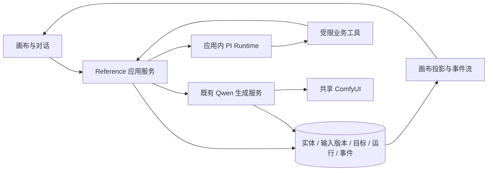

# 实体创建：无限画布与 PI Agent 协作设计 v0.2

> Owner: Sean。2026-10-07。状态：待用户审阅的设计草案，未授权施工、未创建施工任务。本文定义新画布版本，既有实现状态以链接文档和源码为准。

v0.2 调整：依据用户进一步澄清，讨论可以来自小说、剧本或闲聊，可同时涉及多实体及关系。取消“工作区唯一主对话 / 每实体唯一对话”的二选一；讨论与对象是多对多。取消强制以现有 Reference 应用为宿主的决定，先冻结领域与交互契约，再评估独立开发或增量改造。参考分析见 [Seedance Director 调研](sean_seedance_director_research_20261007.md)。

## 1. 目标与已确认边界

第一期验证用户在画布中查看实体资料、固定图片流程、运行和结果，选中具体对象与 PI 交互，并在原位置完成反馈、再生成和确认。实体创建功能只做到支撑这一闭环。

- 当前 Codex 是系统开发层：负责分析、设计及未来开发。画布内 PI 是产品运行层：负责用户的实体创作。两层身份、任务和进度分别记录。
- 图像工作流使用 Qwen Image 2.1。Krea2 的旧参数和参考数量限制不作为本版本基线。
- 工作流结构固定；用户与 PI 改输入、提示词、参数和候选选择。画布不提供节点拖动、接线或结构编辑。
- PC 优先；第一期支持多对象讨论和资料来源链接，真实生成验收贯通一个实体的一条概念图片流程及一次反馈再生成。
- 剧本编辑、拍摄本、视频生成、声音、多视图、复杂关系可视化和自主多轮优化暂不纳入。保留剧本段落引用契约；多实体讨论及基础关系提案属于首期。
- 本轮只交付设计；用户确认设计后创建施工任务，由用户启动施工。

## 2. 现有能力与复用判断

| 现有部分 | 已有契约或能力 | 本期处理 |
|---|---|---|
| `reference-workspace` | 独立 React/Node 应用、SQLite、实体及媒体存储 | 候选复用来源，是否作为宿主待架构评估 |
| Qwen catalog / 生成服务 | 固定模板、参数校验、引用顺序、运行快照、产物回收 | 复用，不另建生成引擎 |
| Agent workspace / PI runtime | PI SDK、应用会话、上下文快照、受限工具、事件及恢复 | 扩展选择上下文与执行工具 |
| 实体创作提案及步骤修订 | 不可变方案、步骤版本、采用及冲突检查 | 保留语义，原位呈现 |
| 运行与主形象 | 候选、历史运行、显式主形象选择 | 直接映射画布结果和确认操作 |
| `film-editor` PI 接入 | 开发/制作分层、身份、版本、幂等与结果回流经验 | 只参考；不移植影片流程或强制 Task Center 绑定 |

已定位的断点：PI 提案后，用户需去其他区域采用、载入生成输入和启动；反馈修改是否进入有效生成输入不够直观。新版本优先消除这些跳转，并展示实际生效输入。

两项目统一产品交互方向，第一期不要求合并代码、数据库和服务。也允许新建独立画布应用，通过适配器借鉴既有生成与 PI 能力。未来视频模块消费稳定实体/资产版本接口，另行设计。

证据入口：

- [当前 Reference 使用与 Qwen 流程](../../reference-workspace/README.md)
- [PI 接入及权限](../../reference-workspace/docs/agent-integration-v1.md)
- [实体创作流程](../../reference-workspace/docs/entity-authoring-workflow-v1.md)
- [步骤修订](../../reference-workspace/docs/workflow-step-revisions-v1.md)
- [批次执行](../../reference-workspace/docs/authoring-batches-v1.md)
- [影片 PI 接入参考](../../film-editor/PIWEB_IMPLEMENTATION.md)

早期 docs/47、docs/49 和 `reference-entity-authoring` skill 含 Krea2 或旧页面约束，不是本期模型和交互规范。施工时需注册 Qwen 对应方法包，不直接给 PI 加载旧 Krea2 skill。

## 3. 界面与空间组织

一个项目提供一个画布工作区，支持展开多份资料、讨论、实体及关系。左侧是对象索引与定位，中央是自动布局画布，右侧是当前 PI 讨论与本轮上下文。属性编辑在选中卡片附近或详情抽屉打开。可聚焦单实体创作，也可返回多对象分析。

```text
项目 / 实体列表      自动布局画布                         PI 对话
                    [实体说明 + 目标]                    当前实体 / 所选版本
                    [参考图组] → [图片步骤] → [本轮结果]   本轮带入的资料
                                  ↓                      对话与工具活动
                              [新输入版本] → [新结果]     待决定事项
```

画布支持平移、缩放、适配全图、聚焦当前步骤、图片原图查看、两图并排比较。连线只说明实际输入与结果来源，不可编辑。历史默认折叠为带数量的组，可展开查看。

新增结果追加在对应运行位置，保留稳定卡片 ID 和位置；不自动重排全图、不抢夺当前视口。用户点击“定位结果”再移动视口。选择、缩放和展开属于浏览状态，不修改创作事实。

画布对象：

| 对象 | 默认展示 | 选中后的操作 |
|---|---|---|
| 实体说明 | 名称、描述摘要、当前目标 | 编辑、交给 PI 讨论 |
| 参考图组 | 同尺寸缩略图、明确顺序 | 查看、增减引用、改变输入顺序 |
| 图片步骤 | 提示词摘要、模板、参数、输入版本 | 展开实际输入、编辑、与 PI 修订、生成 |
| 运行 | 排队/执行/回收/失败/未知、真实进度 | 查看来源、错误、定位结果、有限取消 |
| 结果组 | 本轮候选、当前确认标记 | 放大、比较、反馈、设为主形象、作为下一轮参考 |
| 修改提案 | 新旧差异、有效输入是否改变 | 编辑、采用、拒绝、基于此生成 |

阶段概览固定为“资料 → 输入 → 生成 → 结果检查”。同阶段的迭代是版本和运行历史，不生成可编辑流程图。采样百分比只在执行器实际提供时显示，等待和回收不虚构百分比。

## 4. 完整交互示例

1. 用户新建实体，写描述并加入参考图；画布即时显示资料卡。
2. 选中实体/图片，说“按这些做一张人物概念图”。系统在发送前展示目标实体、引用图顺序和执行范围。
3. PI 读取所选上下文及 Qwen 方法包，生成结构化输入草案。缺少必要信息时在对话和步骤卡标出问题；非必要未知允许保留。
4. 用户可展开提示词/参数直接改，或继续对话。执行策略按第 5 节确认后的模式处理。
5. 服务固定模板和输入版本并建立 run。画布显示排队、执行和回收，PI 对话显示启动了哪个 run。
6. 完成后候选出现在该 run 的结果组。生成完成与 PI 回复结束分别显示；不把文字回复当作生图完成。
7. 用户选中候选，说“保留人物与服装，把背景改成白色，再生成一次”。PI 读取该结果和原输入，形成新版本并启动一轮；旧结果保留，可并排比较。
8. 用户点击“设为主形象”，服务调用既有确认接口。PI 可以建议，不能自行确认。
9. 刷新后恢复实体、当前确认图、输入版本、运行与讨论；未完成生成继续查询原 run。

仅选中图片不等于下一次生成采用该图。对话选图是讨论范围；生成引用是输入草案中明确列出的有序 assetId。两者分别显示，PI 变更生成引用时在差异中说明。

## 5. PI 执行与授权

### 执行强度：待结合讨论和动作范围确认

暂定基线“明确指令执行一次”：只讨论时只读/提案；明确要求生成时允许针对当前实体一次执行。若用户明确要求“修改后生成”，可将本次新参数/提示词作为运行输入，不等同于永久采用设定或确认形象。讨论范围与执行授权分开；多实体关系分析不自然扩展成批量生图授权。最终授权交互需随完整流程一起审阅，尚未定稿。

服务必须保存用户指令对应的 ActionIntent：目标实体、选中版本、动作类型、允许的输入修改范围、最多一次提交、有效上下文版本。PI 提交时关联该 intent，服务消费一次授权；重放返回原 action/run。模型自称获得授权无效。

生成工具不得顺带修改实体事实、关系或当前主形象。新增实体、应用描述提案和正式采用步骤版本分别显式操作；初期若难以可靠解析自然语言执行范围，则显示“生成这一版”按钮完成授权，保留同一画布交互。

输入歧义、范围扩大或必要引用缺失时先显示问题。无输入变化但用户明确要求换 seed 可生成；否则提示修改未进入实际输入，不能宣称已修正。

### 讨论与对象的归属（v0.2）

Discussion 是独立持久对象，可关联多份 SourceDocument、多个 Entity、Relation、输入步骤及结果。实体可出现在多段讨论中；不存在一个实体只能有一个会话的约束。PI 原生会话绑定 discussionId，模型切换或历史压缩不改变讨论与对象链接。

从小说段落开始讨论时，可以尚无实体；PI 先提出候选实体及关系，用户采用后分配稳定 ID。候选 key 不能冒充正式 entityId。闲聊也可以创建讨论，不强制创建远程任务、剧本或空实体。

界面提供“继续相关讨论”和“新开讨论”，用户可在当前讨论增减上下文，或基于选中对象建立新讨论。点击卡片只定位；本轮显式选择加上固定资料组成 ContextSet，发送前可见。上轮已经进入 PI 历史的内容不会因取消选择而被真正遗忘：要求隔离时开启干净会话，只转入用户选择的已确认资料和摘要。

每轮发送时固定上下文及版本；执行途中点击其他对象只影响下一轮。讨论可同时分析多个实体，但每个生成动作明确一个 targetEntityId 和输入快照。首期单项目一次一个 PI 执行轮次，人工/PI 写同一实体均做版本比较。

讨论结论通过 Decision/Proposal 保存到对应实体、关系或项目设定；明确列出涉及对象、原文位置、讨论消息来源和采用状态。多实体关系提案原子采用，避免只更新一端。保存结论不改小说原文、不自动改剧本。

### PI 和长生成任务

PI 调用执行工具得到 actionId/runId 后可结束当前回复。生成服务独立观察 ComfyUI，结果由应用事件回流；不让一次模型调用阻塞等待整轮采样。

第一期生成完成不自动再次调用模型。用户选中结果继续反馈或请求检查时开启下一轮 PI。视觉检查必须实际读取图片，报告不能代替用户采用。

## 6. 数据、任务与记忆



应用结构化存储和素材存储是业务真源，SQLite 可作为本机版本的实现选择。画布是这些对象的投影，不维护第二套步骤或结果事实。PI 工具和人工编辑调用同一业务服务；不要求沿用旧数据库 schema。

| 层 | 用途 | 本期决定 |
|---|---|---|
| Codex 开发 Task Center | 开发目标、设计引用、施工 checkpoint、交付验收 | 设计确认后建立独立施工任务 |
| 产品内本地创作目标 | 用户目标、当前实体、待决定事项、结果引用、恢复摘要 | 最小版本保存在应用库 |
| 产品内远程 Task Center | 未来跨会话/跨执行器任务调度 | 第一期开关关闭，不强制绑定 |
| Mem0 | 跨工作区偏好、稳定经验 | 不做实时状态存储；首期无强依赖 |
| PI 会话历史 | 讨论与工具记录 | 复用应用持久化，会话摘要不能覆盖实体事实 |

产品中的本地创作目标不是远程任务状态。未来启用远程绑定时，远程生命周期/controller/generation 以 Coordinator 为准，本地仅保留业务内容和映射，不自造 controller。

新增最小记录（具体表名可在施工时调整）：

- SourceDocument/SourceAnchor：小说、剧本、笔记的不可变原文修订，以及段落/字符范围/hash；聊天来源用 discussionId/messageId 引用。原文新版本保留旧锚点，必要时标记待重新定位。
- Discussion/DiscussionObjectLink：主题、PI 会话绑定、引用对象及角色（资料/目标/对照）、待决定问题；对象链接是多对多。
- Decision/Proposal：候选结论、依据、涉及对象与目标修订、用户采用/拒绝记录。已采用结论进入业务对象，聊天总结不能隐式取代。
- WorkspaceGoal：workspace/project、可空 discussionId、目标对象集合、目标正文、active/paused/awaiting_user/achieved、待决定事项、结果引用、revision。
- SelectionSnapshot：本轮明确 entity/step/asset/run ID 与版本；保存在消息和运行依据中。
- CanvasViewState：视口、展开组、选择、布局版本；与业务修订分离。
- CanvasAction：requestId、intent、source hashes、提交状态、实际输入 hash、runId、PI session/run 来源。
- WorkspaceEvent：workspace 内递增 seq、对象 ID、版本和事件类型；承载人工/PI/生成变更通知。

复用旧服务时沿用其实体/资产/步骤/run；独立开发时通过适配器映射稳定 ID，并确定唯一业务真源，禁止新旧应用同时各维护一套现行事实。输入修订不覆盖历史；“采用步骤”“本次使用输入”和“确认主形象”分别记录。

未来 StoryLink 使用 projectId/sourceId/sourceRevision/anchorId/entityId/entityRevision/decisionId，不复制实体长文到剧本作为另一份设定。剧本消费明确版本；实体更新产生影响提示，不自动覆盖剧本内容。首期只保存与展示资料引用，不开发视频流程。

## 7. 上下文与工具契约

默认上下文：当前讨论目标摘要、已固定项目规则、本轮显式选入的资料段落/实体/关系、目标步骤及相关结果；长小说只按锚点取片段。用户可查看模型实际读过的对象。已链接但未选入的对象默认只给索引，需要时在项目范围内受限读取并记录，不默认加载整个项目、全部历史图片或开发 AGENTS。跨项目资料只有明确导入/引用后可用。

模型 PI 与图像 Qwen 是不同配置：PI 使用应用已有可用的视觉/工具模型；Qwen Image 2.1 是固定图片执行器。

新增/复用工具意图（名称为拟议契约）：

| 工具 | 能力 |
|---|---|
| get_workspace_context | 读取本轮目标和选择快照 |
| get_entity / get_image_step / view_reference_image | 受限读取资料、完整输入与像素 |
| load_authoring_skill | 仅加载登记的 Qwen 实体创作方法包，记录版本/hash |
| propose_entity_update / propose_image_step_revision | 保存候选和新旧差异 |
| preview_generation_input | 返回编译后的实际提示词、参数、有序引用、模板 hash 和差异 |
| submit_generation_action | 核对有效 intent 和输入版本后调用现有生成服务，返回 runId |
| get_generation_run | 查询已关联 run，不重复提交 |
| propose_image_review | 保存实际看图范围内的建议，不确认主形象 |

PI 不获得 shell、任意路径、任意节点 JSON、全局配置修改或 ComfyUI 生命周期工具。skill 选择由操作范围和注册表决定，不由画布卡片提供任意代码。

## 8. 接口与事件（拟议）

- `GET /api/canvas/workspaces/:id`：目标、业务对象投影、revision、最新事件 seq。
- `PATCH .../goal`：正文和 expectedRevision；返回持久化目标。
- `PATCH .../view`：视口与折叠状态；不影响业务修订。
- `POST .../messages`：requestId、sessionId、text、SelectionSnapshot、ActionIntent；绑定本轮上下文。
- `POST .../actions`：从当前输入或候选建立单次生成动作；显式授权、expected hashes、幂等键。
- `GET .../events?after=seq`：SSE，支持断线续传；无法补齐时重新读取快照。

若在旧宿主增量实现，现有生成/资产/确认 API 保留，新接口作为协调层；若独立开发，适配器提供同等运行语义，不强制保留旧路由。数据库事务内写入业务变化及事件；若沿用已有接口无法一次完成，则需要补事件 outbox，避免界面收到事件但事实未保存。

事件类型至少覆盖 goal.updated、proposal.created、input.revised、action.accepted、run.queued、run.progress、run.finished、asset.created、appearance.confirmed、conflict。客户端按 seq 和对象 revision 幂等应用，重连不叠加重复候选。

## 9. 并发、失败与恢复

- 一个实体同时最多一个修改/提交动作；PI 和人工操作都用 expectedRevision/hash 检查。用户仍可浏览，冲突时保留提案并重新加载，不覆盖。
- 输入编辑不改变已提交 run；运行中的卡片继续展示原输入。
- 资料更新只标记实际依赖的结果“依据已变化”，不自动再生成，不取消既有确认版本。
- 页面关闭不停止已授权生成；取消 PI 回复不等于取消 ComfyUI。两个按钮和状态分别表达。
- 队列取消仅作用于本次排队 run；运行中的共享任务不能全局 interrupt，页面说明仍会完成。
- 超时显示“仍在查询”；提交结果未知时保留 actionId/request key，先核对原 run/prompt_id，不自动重试。
- PI 中断保留输入提案；服务重启后按既有 run 恢复观察，不重发模型请求或生图请求。
- Task Center 或 Mem0 不可用不影响首期实体数据与画布闭环；未来启用远程任务模式时查询失败按远程协议暂停相应任务操作。
- 实际图片通过既有回收服务进入应用素材库；ComfyUI output 仍是临时落点。

## 10. 实施阶段与验收

1. 资料与讨论画布：文本片段、讨论、多实体/关系候选、输入与结果自动布局；选中、聚焦、比较、刷新恢复。无模型调用即可演示。
2. PI 选择交互：稳定选择快照、上下文可见、真实 PI 对话和修订提案回到对应卡片，实际编译输入差异可查看。
3. 单次执行：明确授权 → 固定 Qwen 流程 → 真实进度与结果 → 选中反馈 → 新运行 → 用户确认主形象。
4. 恢复与交付：重连、版本冲突、重复请求、未知提交和旧页面兼容；形成可复现操作与证据。

施工验收场景：

- 不离开画布完成一个实体两轮生成、比较并确认；PI 使用真实模型，图片使用真实 Qwen，模拟运行明确标注。
- 从一段小说或闲聊开始，讨论两个实体及关系，分别采用实体与关系结论；同一实体可在另一讨论继续修改并追溯来源。第一期只支持小段文本录入/已有文本引用，不承诺整部小说自动解析。
- 第二轮变化确实进入 compiled input、run snapshot 和提交图；图片效果由用户判断，不以生成成功宣称质量改善。
- 点击其他实体不会改变已发送轮次的目标；选择讨论图不会隐式成为生成引用。
- 刷新和 SSE 重连后不重复提交、重复卡片或丢失当前确认结果。
- 人工修改后旧 PI 提案被冲突检查阻止；取消 PI 不误中断共享生成。
- 不绑定开发任务也能完成产品闭环；旧实体、历史和原页面继续可读取。

首期画布组件选型在施工起始做小型验证：必须支持 React 自定义卡片、平移缩放、禁用编辑连线、稳定自动布局、图片懒加载和键盘聚焦。尚未做外部组件调研，不在本文把具体库写成已选定方案。折叠历史及只渲染视口附近卡片避免历史增长导致全部图片解码。

## 11. 设计审阅与施工任务草案

下一步需综合审阅讨论上下文、结论采用与生成授权交互，不再要求通过独立二选一冻结执行方式。会话归属已按用户要求改为多对象讨论；需评估新应用与旧宿主两个实现选项，不将旧宿主作为已确认决定。

施工标题建议：`[Sean] 实体画布 v1：自动布局与 PI 单次 Qwen 创建闭环`。

任务描述应引用本文件最终确认版本，明确选定的应用宿主、数据边界和不施工视频流程，按第 10 节验收。创建前再次查询现有远程任务，标出旧任务重叠但不自行 complete/reopen/接管；任务创建后保持 queued，由用户启动。

本次盘点为文档与代码只读分析，未调用 PI 推理、未访问/操作 ComfyUI、未运行测试，未验证画布实现或组件性能。
